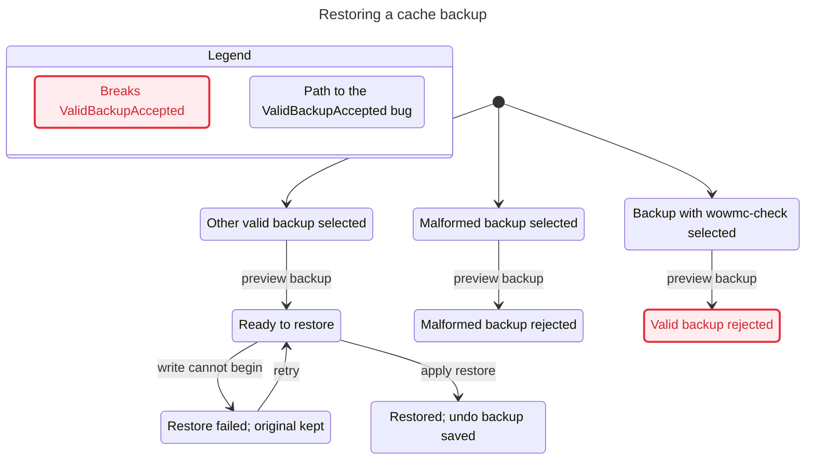
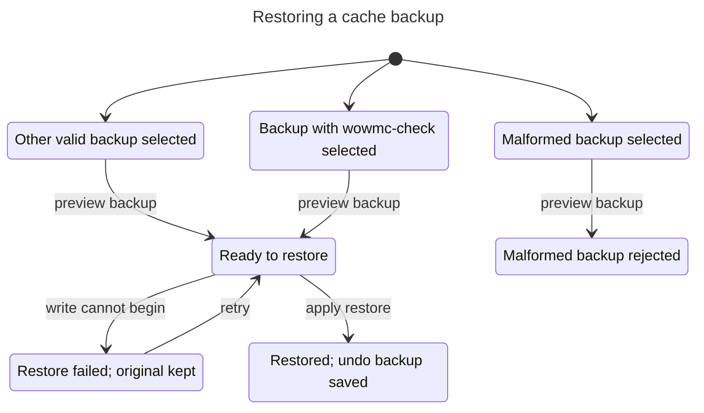
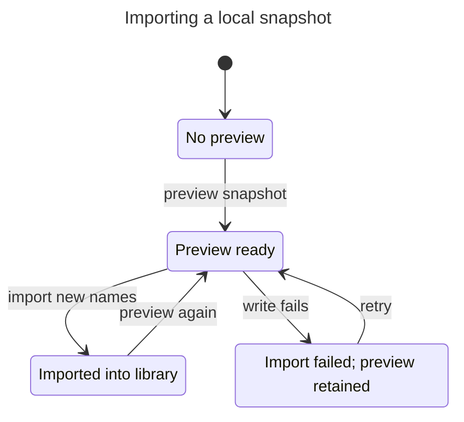
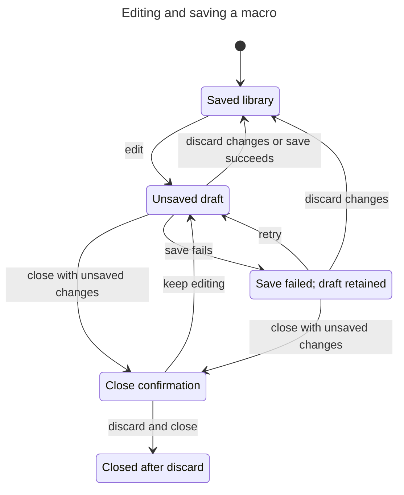
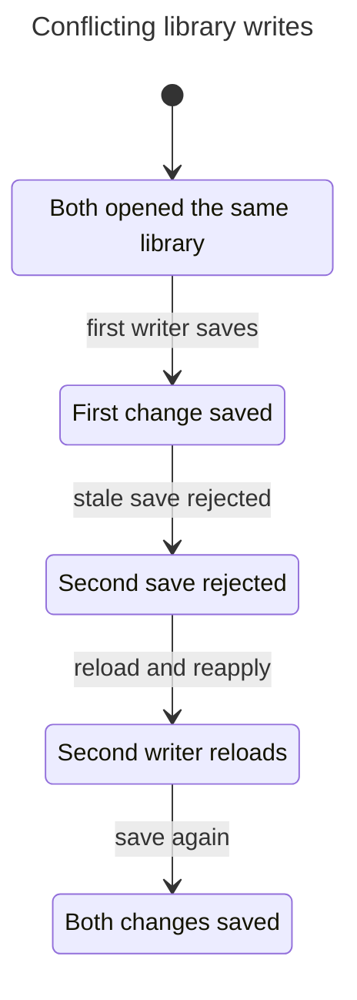
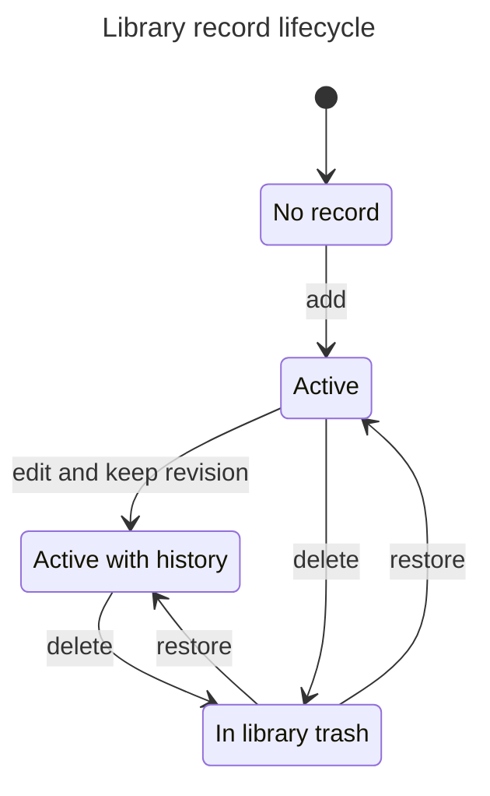
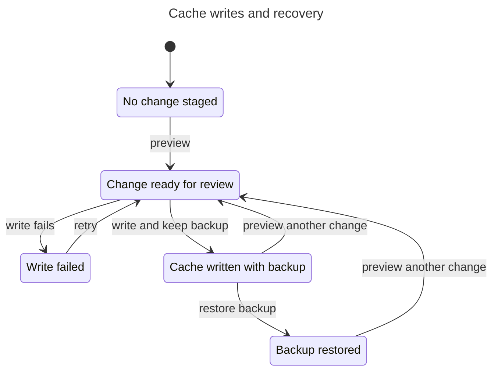

# Model checks — November 6, 2026

Checked with TLC 1.7.4 (pinned checksum), Java 22.0.2, Node 24.15.0 on Windows.
Counts describe the finite abstractions, not application coverage or reliability.

The restore counterexample was replayed against the real CLI and captured in
`restore_accepts_valid_backups_independent_of_macro_names`: the test failed
before the change and passes afterward. Rule `ValidBackupAccepted` means
“a supported backup must not be rejected because of a macro's name.”
Shortest path: **0. Backup with wowmc-check selected → 1. preview backup:
Valid backup rejected**.

The restore model covers validation, preview, a failure before writing, retry,
and a completed restore with an undo backup. It excludes partial writes, crashes,
rollback failure, external writers, and in-game behavior. Import models one
logical name and atomic library saves; it does not prove parsing, conflict
resolution for arbitrary datasets, or filesystem behavior. Application tests
provide separate evidence for those implemented cases.

Reproduce with new output directories (automatically selected when `-Out` is omitted):

```powershell
.\statecharts\run.ps1 -Model RestoreBefore -ExpectViolation
.\statecharts\run.ps1 -Model RestoreAfter
.\statecharts\run.ps1 -Model ImportLifecycle
```

The remaining models were rechecked unchanged; their scope limitations are in
`statecharts/README.md`. Charts omit transitions that stay in the same displayed
state, including terminal “finished” steps. No additional transitions are hidden.


## restore-before

TLC reached 10 states and 11 steps. The chart draws 8 states and 6 arrows.
The chart does not draw 4 steps that stay in one chart state.

## ValidBackupAccepted breaks
The shortest path has 1 step:
0. Backup with wowmc-check selected
1. preview backup: Valid backup rejected

## Rules that hold
MalformedNeverWritten, PreviewDoesNotWrite, BackupBeforeRestore, NoDeadlock



## restore-after

TLC reached 12 states and 14 steps. The chart draws 7 states and 6 arrows.
The chart does not draw 4 steps that stay in one chart state.

## Rules that hold
ValidBackupAccepted, MalformedNeverWritten, PreviewDoesNotWrite, BackupBeforeRestore, NoDeadlock



## import

TLC reached 6 states and 8 steps. The chart draws 4 states and 5 arrows.

## Rules that hold
GameUntouched, NoDuplicate, FailedKeepsPreview, PublishedOnlyAfterSave, NoDeadlock



## save-after

TLC reached 10 states and 22 steps. The chart draws 5 states and 9 arrows.
The chart does not draw 2 steps that stay in one chart state.

## Rules that hold
SavedMeansDurable, MemoryMeansDurable



## writers-after

TLC reached 5 states and 5 steps. The chart draws 5 states and 4 arrows.
The chart does not draw 1 steps that stay in one chart state.

## Rules that hold
NoLostUpdate



## record

TLC reached 5 states and 7 steps. The chart draws 4 states and 6 arrows.
The chart does not draw 1 steps that stay in one chart state.

## Rules that hold
TrashRecoverable



## cache-writes

TLC reached 11 states and 16 steps. The chart draws 5 states and 7 arrows.

## Rules that hold
BackupBeforeWrite


