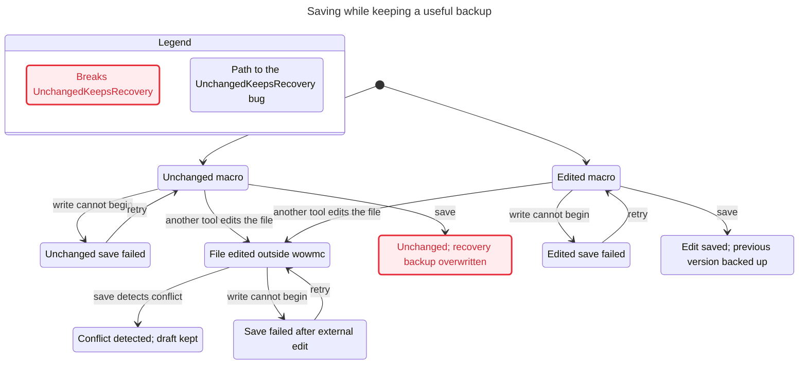
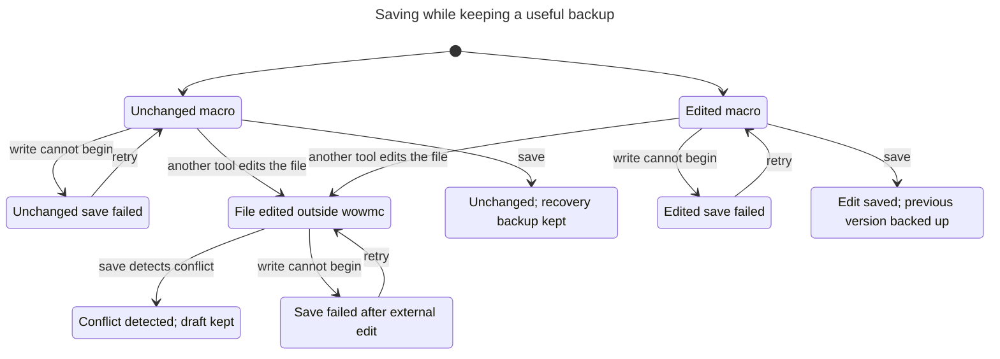

# Review and fixes — November 6, 2026

## Findings and dispositions

This pass reviewed storage, cache parsing, command dependencies, and GUI recovery
in the local 0.1.0 checkout. Source inspection was followed by executable
reproductions and a separate critical pass over the resulting diff. This was a
single-agent review, not an independent second review.

| Finding | Observed failure | Resolution |
| --- | --- | --- |
| Library sidecar collisions | Saving `library.lock` locks the data file itself; `library.json.bak` has no distinct backup. | Keep the normal lock path for compatibility, append `.lock` when the library itself ends in `.lock`, and append `.bak` to the full library filename. |
| Unchanged saves erase useful recovery data | A second unchanged save replaces the previous version's backup with the current version. Different JSON formatting causes the same problem. | Compare persisted record content after the stale-writer check; leave both files untouched on a no-op. |
| Unsupported cache headers accepted for writes | Missing whitespace before a name and extra unknown header fields pass strict validation. | Keep permissive reads; reject unsupported headers before install or restore writes. |
| Unneeded library configuration | Setup and cache restore fail when `APPDATA` and `WOWMC_LIBRARY` are unset, even with their own explicit paths. | Resolve the library path only in commands that use the library. |
| Duplicate library IDs | A malformed library with repeated IDs loads successfully and can select an arbitrary matching record. | Validate unique IDs before accepting or persisting a library. |
| GUI save-conflict recovery | Repeated saves remain blocked; the interface provides no reload action. | Add **Reload library (keep draft)**, remap selection by stable ID, and require an explicit discard/copy decision if the selected record was removed. |

All findings were acted on. Seven regression cases were observed failing before
their fixes and passing afterward; two added GUI tests cover conflict/reload/save,
record reordering, and externally deleted drafts. Normal library lock paths and
the default `library.json.bak` backup location remain compatible. For custom
filenames, use the new `<full library filename>.bak`; existing backups are not
deleted or renamed.

## Verification

- Updated CLI package: `dist/wowmc-windows-x64-reviewed-20261106.zip`. Its extracted
  executable matches the release build by SHA-256. Add/delete operations using
  both `library.lock` and `library.json.bak` pass against the packaged executable,
  and each backup contains the exact previous file contents.
- `powershell -File scripts/check.ps1`: formatting, Clippy with warnings denied,
  and all **35 tests** pass (4 library, 4 GUI, 27 integration).
- `powershell -File scripts/check.ps1 -Models`: all **seven current models** pass.
- `LibrarySaveBefore -ExpectViolation` detects the old failure; the same rules
  hold for `LibrarySaveAfter`. Each explores 12 states and 18 steps.
- The `UnchangedKeepsRecovery` rule means “saving an unchanged macro must keep
  the previous recovery version.” Its shortest failing path is:
  **0. Unchanged macro → 1. save: Unchanged; recovery backup overwritten**.
  This path was replayed in
  `unchanged_save_keeps_the_last_distinct_backup_and_still_checks_conflicts`.
- A second test verifies this behavior with compact JSON, so formatting alone
  cannot trigger an unnecessary write or overwrite a backup.

## Reproduce the statecharts

```powershell
.\statecharts\run.ps1 -Model LibrarySaveBefore -ExpectViolation
.\statecharts\run.ps1 -Model LibrarySaveAfter
```

Omitting `-Out` chooses a fresh temporary output directory; pass a new path to
retain results elsewhere. The runtime and checksum-pinned TLC setup are described
in `statecharts/README.md`.

The model abstracts a previously saved file, a previous backup, an unchanged or
edited draft, failures before writing, and an external edit before a save.
It excludes partial writes, crashes, filename aliasing, real lock behavior,
simultaneous external writes during a save, and GUI reload. The corresponding
code tests provide separate evidence; no model proves implementation conformance.

Charts omit four steps whose labels do not change, including terminal “finished”
steps. No additional transitions are hidden. Live game behavior, visual GUI
inspection, and first-time-user usability were not exercised in this pass.

## library-save-before

TLC reached 12 states and 18 steps. The chart draws 9 states and 11 arrows.
The chart does not draw 4 steps that stay in one chart state.

## UnchangedKeepsRecovery breaks
The shortest path has 1 step:
0. Unchanged macro
1. save: Unchanged; recovery backup overwritten

## Rules that hold
ChangedBacksUpPrevious, SavedMatchesDraft, ConflictLeavesFilesAlone, FailureDoesNotPublish, NoDeadlock



## library-save-after

TLC reached 12 states and 18 steps. The chart draws 9 states and 11 arrows.
The chart does not draw 4 steps that stay in one chart state.

## Rules that hold
UnchangedKeepsRecovery, ChangedBacksUpPrevious, SavedMatchesDraft, ConflictLeavesFilesAlone, FailureDoesNotPublish, NoDeadlock


